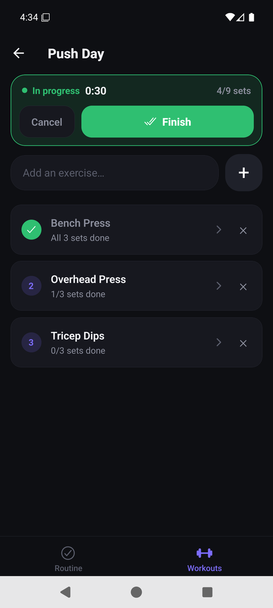
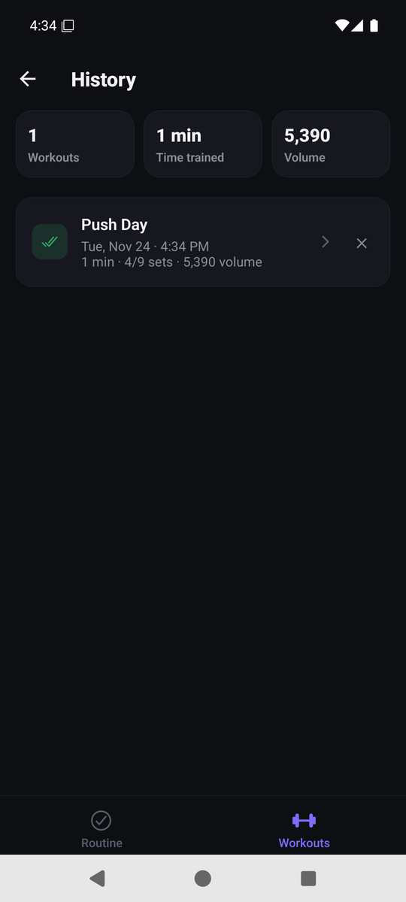

# Habits Tracker

An Android app for a daily routine checklist and a workout log, backed by a .NET API and PostgreSQL.

- **Routine:** a checklist you reorder by holding and dragging. Checked items reset at midnight.
- **Workouts:** named workouts, each with a list of exercises and sets (reps and weight). Start a workout, check sets off as you go, then finish to log it in your history.

<p align="center">
  
  
  
  
</p>

---

## Install on your phone


1. On your Android phone, scan the QR code with the camera app. It opens the latest APK:
   <https://github.com/Chasertx/HabitsTracker/releases/latest/download/HabitsTracker.apk>
2. Open the downloaded `HabitsTracker.apk`. If Android asks, allow your browser to **install unknown apps**.
3. If Google Play Protect warns that the app is unrecognised, choose **Install anyway**. The app is signed by this project's own key, not by the Play Store.

Installing a newer release over the old one keeps your data, because the data lives on the server.

> The app needs an internet connection. The free server sleeps after 15 minutes idle,
> so the first screen after a break can take up to a minute to load.

---

## Features

### Routine
- **Add items:** type in the box under the title, then tap **+** (next to the title) or press Enter.
- **Check items off.** The progress bar at the bottom shows how many are done.
- **Reorder:** hold an item about a third of a second until it lifts, then drag it.
- **Delete:** tap **×** once to arm it (it turns red), then tap it again within 3 seconds.
- **Midnight reset:** checked items come back unchecked after midnight in your phone's time zone.
  - If an unchecked item with the same name already exists, the checked copy is removed instead of creating a duplicate.
  - Names are compared ignoring case and surrounding spaces.
  - The reset happens when the list loads, so it still applies if the app or server was off at midnight.

### Workouts
- **Create workouts** by name. Each shows its exercise count, and an **In progress** label while it's running.
- **Open a workout** to add or remove exercises. Each exercise shows how many of its sets are done.
- **Open an exercise** to log its sets:
  - **Add set** copies the previous set's reps and weight.
  - Edit reps and weight inline. Changes save when you leave the field or the screen.
  - **Check off a set** by tapping its number; it turns green.
  - Once every set is checked, the exercise is marked complete with a green check.
  - Remove a set with the two-tap **×**.
- **Run a workout:**
  1. Tap **Start workout**. This starts a timer and clears last time's checks.
  2. Check sets off as you go. The bar shows elapsed time and how many sets are done.
  3. Tap **Finish** to save the session to history, or **Cancel** then **Discard?** to throw it away.
- **History** (clock button next to **+** on the Workouts tab) lists every finished session:
  - Totals for workouts, time trained and volume (reps × weight of completed sets).
  - Each session shows its date, duration and every set, with done or skipped marked.
  - A history entry keeps its snapshot even if you later edit or delete the workout.
- Weight is unitless: use lb or kg consistently.

The Routine and Workouts tabs stay visible on every screen, and sit above the phone's on-screen navigation buttons or gesture bar.

---

## How it fits together

```
┌────────────────────────────┐   HTTPS + X-Api-Key   ┌─────────────────────────────┐        ┌──────────────────┐
│  mobile/  (Android app)    │ ────────────────────▶ │  api/  (.NET 8 minimal API) │ ─────▶ │  PostgreSQL 16   │
│  Expo SDK 58 · React       │                       │  EF Core · Docker           │        │  Render (free)   │
│  Native 0.88 · Expo Router │ ◀──────────────────── │  Render web service (free)  │ ◀───── │                  │
└────────────────────────────┘          JSON         └─────────────────────────────┘        └──────────────────┘
```

| Part | Tech | Where it runs |
| --- | --- | --- |
| `mobile/` | Expo SDK 58, React Native 0.88, React 19, TypeScript, Expo Router (tabs + stacks), Reanimated 4, Gesture Handler 3 | Android phone (sideloaded APK) or an emulator via Expo Go |
| `api/` | .NET 8 minimal API, EF Core 8 with Npgsql and migrations, packaged as a Docker image | Render free web service, deployed from this repo by `render.yaml` |
| Database | PostgreSQL 16 | Render free Postgres in production; Docker (`docker-compose.yml`) locally |

---

## Repository layout

```
.
├── api/                         .NET 8 API
│   ├── Program.cs               Startup: database, CORS, API key, endpoint mapping
│   ├── Endpoints/               Items (routine), Workouts + sessions, Exercises and sets, History
│   ├── Models/                  ListItem, Workout, Exercise, ExerciseSet, WorkoutSession
│   ├── Data/
│   │   ├── AppDbContext.cs      EF Core model and relationships (cascade deletes)
│   │   └── DatabaseConfig.cs    Reads DATABASE_URL or ConnectionStrings:Default
│   ├── Services/
│   │   ├── DailyReset.cs        Midnight reset and duplicate rules
│   │   └── ApiKeyMiddleware.cs  Optional X-Api-Key check for /api routes
│   ├── Migrations/              EF Core migrations, applied on startup
│   └── Dockerfile               Production image built by Render
├── mobile/                      Expo / React Native app
│   ├── src/app/                 Routes (Expo Router)
│   │   ├── (tabs)/index.tsx     Routine tab
│   │   └── (tabs)/workouts/     Workouts tab: list, workout, exercise (sets) and history screens
│   ├── src/components/          Shared UI: DraggableList, DeleteButton, SessionBar, rows, header, composer
│   ├── src/api.ts               Typed API client
│   ├── app.json                 Expo config (name, package id, icons)
│   └── eas.json                 EAS cloud build profiles (optional)
├── scripts/
│   ├── release-android.ps1      Build the APK (Docker, local or EAS) and publish a GitHub Release
│   └── build-apk-in-docker.sh   The build steps run inside the Docker container
├── docs/                        README images (screenshots, install QR code)
├── docker-compose.yml           Local PostgreSQL for development
└── render.yaml                  Render Blueprint: API service and Postgres database
```

---

## Local development

### Prerequisites
- [.NET 8 SDK](https://dotnet.microsoft.com/download/dotnet/8.0)
- [Node.js](https://nodejs.org/) 20 or newer
- [Docker Desktop](https://www.docker.com/products/docker-desktop/), for local PostgreSQL
- Android Studio, with an Android emulator (AVD) set up
- Optional, for releases: [GitHub CLI](https://cli.github.com/), and CMake 3.31.6 from the Android SDK (`sdkmanager "cmake;3.31.6"`) for local APK builds on Windows. An [Expo](https://expo.dev/) account is only needed for EAS cloud builds

### 1. Start PostgreSQL
```powershell
docker compose up -d                     # postgres:16 on localhost:5432 (user/password/db: habits)
```

### 2. Run the API
```powershell
cd api
dotnet run --launch-profile http        # http://localhost:5248
```
On startup it applies all migrations to the local database. Locally no API key is required.

### 3. Run the app in the emulator
```powershell
cd mobile
npm install
npx expo start --android                # installs Expo Go on the emulator and opens the app
```
The emulator reaches your PC's `localhost` at `10.0.2.2`, which the app uses by default.

To run against the deployed API instead, set these before `npx expo start`:
```powershell
$env:EXPO_PUBLIC_API_URL = "https://habits-tracker-api-ilt7.onrender.com"
$env:EXPO_PUBLIC_API_KEY = "<the API key>"
```

### Checks
```powershell
cd mobile; npx tsc --noEmit; npx expo lint
cd api;    dotnet build
```

### Changing the database schema
```powershell
dotnet tool restore                      # installs dotnet-ef from .config/dotnet-tools.json
cd api
$env:ASPNETCORE_ENVIRONMENT = "Development"
dotnet ef migrations add <Name>
```
Migrations run automatically when the API starts, both locally and on Render.

---

## API reference

All `/api` routes take and return JSON. When the `ApiKey` setting is set (it is in production), each `/api` request needs an `X-Api-Key` header.

| Method | Route | Purpose |
| --- | --- | --- |
| GET | `/health` | Liveness check (no key needed) |
| GET | `/api/items?timeZone=America/Chicago` | Routine items in order. Applies the midnight reset for that IANA time zone first |
| POST | `/api/items` | Add an item `{ "title": "..." }` |
| PATCH | `/api/items/{id}` | Update `{ "title"?, "isCompleted"? }` |
| PUT | `/api/items/order` | Reorder `{ "ids": [3, 1, 2] }` |
| DELETE | `/api/items/{id}` | Delete an item |
| GET | `/api/workouts` | Workouts with exercise counts |
| GET | `/api/workouts/{id}` | A workout with its exercises (and their set counts) |
| POST | `/api/workouts` | Create `{ "name": "..." }` |
| PATCH | `/api/workouts/{id}` | Rename `{ "name": "..." }` |
| DELETE | `/api/workouts/{id}` | Delete a workout, its exercises and their sets |
| POST | `/api/workouts/{id}/start` | Start a session (clears set checks). Returns the workout |
| POST | `/api/workouts/{id}/finish` | Log the running session to history, then reset. Returns `{ sessionId }`; `409` if not started |
| POST | `/api/workouts/{id}/cancel` | Discard the running session |
| POST | `/api/workouts/{id}/exercises` | Add an exercise `{ "name": "..." }` |
| DELETE | `/api/workouts/{id}/exercises/{exerciseId}` | Remove an exercise and its sets |
| GET | `/api/exercises/{id}` | An exercise with its sets |
| PATCH | `/api/exercises/{id}` | Rename `{ "name": "..." }` |
| POST | `/api/exercises/{id}/sets` | Add a set `{ "reps"?, "weight"? }`; omitted values copy the previous set |
| PATCH | `/api/sets/{id}` | Update `{ "reps"?, "weight"?, "isCompleted"? }` (reps 0–1000, weight 0–10000) |
| DELETE | `/api/sets/{id}` | Delete a set |
| GET | `/api/history?workoutId=` | Finished sessions, newest first, with set counts and volume |
| GET | `/api/history/{id}` | A session with its exercises and sets |
| DELETE | `/api/history/{id}` | Delete a session from history |

Invalid input returns `400` with a validation problem body. Unknown ids return `404`.

---

## Deployment

### API and database → Render

[`render.yaml`](render.yaml) is a Render Blueprint that defines two things:
- `habits-tracker-api`: a free Docker web service built from `api/Dockerfile`, with health checks on `/health`.
- `habits-db`: a free PostgreSQL 16 database.

The service gets its settings from environment variables:

| Variable | Value | Purpose |
| --- | --- | --- |
| `DATABASE_URL` | Linked automatically from `habits-db` | The API converts this `postgres://` URL into a connection string |
| `ApiKey` | A random secret, entered when the Blueprint is created | Required as `X-Api-Key` on `/api` requests |
| `PORT` | Set by Render | The port the API listens on |

**First-time setup:**
1. In the [Render dashboard](https://dashboard.render.com/), choose **New → Blueprint**.
2. Connect your GitHub account and pick this repository.
3. Render reads `render.yaml`. Enter the `ApiKey` value when asked, then choose **Apply**.

**Redeploying:** Render redeploys automatically on every push to `main` that changes files under `api/`.

The production API is at **https://habits-tracker-api-ilt7.onrender.com** (health check: `https://habits-tracker-api-ilt7.onrender.com/health`).

**Free-tier limits:**
- The web service sleeps after 15 minutes without traffic and takes up to a minute to wake.
- The free database **expires 30 days after it was created** unless you upgrade it, so upgrade before then to keep your data.
- The free database has 1 GB of storage.

### Android app → APK → GitHub Release

The release APK is built by [`scripts/release-android.ps1`](scripts/release-android.ps1). In every mode, `expo prebuild` generates the native Android project, and then Gradle builds a signed release APK. Use `-Builder` to choose where that happens:

| `-Builder` | Where it builds | Needs |
| --- | --- | --- |
| `Docker` (default) | A Linux container ([`scripts/build-apk-in-docker.sh`](scripts/build-apk-in-docker.sh) in `reactnativecommunity/react-native-android`) | Docker Desktop only. Avoids Windows path-length and antivirus problems. The first run downloads the NDK and Gradle dependencies into Docker volumes |
| `Local` | Your PC, through `mobile/android/` (gitignored) | JDK 17+, the Android SDK, and on Windows CMake 3.31.6 (`sdkmanager "cmake;3.31.6"`) |
| `Eas` | Expo's cloud, using the `preview` profile in `mobile/eas.json` | An Expo account. The free plan allows a limited number of Android builds per month |

The API URL and key are compiled in from these values:

| Value | Where it comes from |
| --- | --- |
| API URL | The script's `-ApiUrl` parameter, which defaults to the Render URL |
| API key | `$env:EXPO_PUBLIC_API_KEY`; it must match `ApiKey` on Render |

Before each release, bump `version` and `android.versionCode` in `mobile/app.json` so Android installs it as an update. Then run:
```powershell
$env:EXPO_PUBLIC_API_KEY = "<the ApiKey value from Render>"
./scripts/release-android.ps1 -Tag v1.0.1 -Notes "What changed"
```
The script builds the APK and creates a GitHub Release with the asset `HabitsTracker.apk`. The QR code always points at `releases/latest/download/HabitsTracker.apk`, so it never needs regenerating.

For EAS builds the API key comes from the EAS environment variable `EXPO_PUBLIC_API_KEY` in the `preview` environment, not from `$env:EXPO_PUBLIC_API_KEY`.

**Signing:** Docker and Local builds are signed with the debug key from the Expo template, which stays the same between builds, so their updates install over each other. EAS builds use a different key stored by Expo. Android won't install an update signed with a different key: if you switch to or from EAS, uninstall the app first. Your data is on the server, so nothing is lost.

To change the API key:
1. Update `ApiKey` in the Render dashboard (service → **Environment**).
2. Use the new value for `EXPO_PUBLIC_API_KEY` when building. For EAS builds, update the variable:
   ```powershell
   cd mobile
   npx eas-cli env:update --variable-name EXPO_PUBLIC_API_KEY --variable-environment preview --value <new>
   ```
3. Publish a new release.

---

## Security notes

- The API key is compiled into the APK. It keeps casual traffic off the public API, but it isn't user authentication. Anyone who extracts it from the app can use the API.
- There are no user accounts: everyone using the same server shares one routine and one set of workouts.
- CORS allows any origin. The phone app doesn't need CORS; this only matters for browser clients.

---

## Troubleshooting

| Problem | Fix |
| --- | --- |
| App shows "Can't reach the server" right after opening | The free Render service was asleep. Wait a few seconds, then pull down to refresh. |
| Data disappeared after about a month | The free Render database expired. Upgrade it in Render before 30 days to avoid this. |
| `dotnet run` fails to connect to the database | Start PostgreSQL with `docker compose up -d`, and check Docker Desktop is running. |
| `dotnet run` fails with *An Application Control policy has blocked this file* | Windows Smart App Control blocks freshly built DLLs. Turn it off in Windows Security → App & browser control. |
| Emulator app can't reach the local API | Make sure the API is running on port 5248. The emulator must use `10.0.2.2`, not `localhost`. |
| Phone refuses to install the APK | Allow your browser or file manager to install unknown apps (Settings → Apps → Special app access). |
| `dotnet build` fails because the `.exe` is locked | A `dotnet run` instance is still running. Stop it first. |
| Gradle fails with *Filename longer than 260 characters* | Enable Windows long paths, install CMake 3.31.6 (`sdkmanager "cmake;3.31.6"`), and add `cmake.dir=<sdk>/cmake/3.31.6` to `mobile/android/local.properties`. The release script writes that file. The SDK's default CMake 3.22.1 bundles Ninja 1.10, which can't handle long paths. |
| Gradle fails with *ld.lld.exe: Access is denied* or *ninja: CreateProcess: Access is denied* | Antivirus is blocking the Android build tools. Build with `-Builder Docker` (the default), or add an antivirus exclusion for the Android SDK and the repo. |
