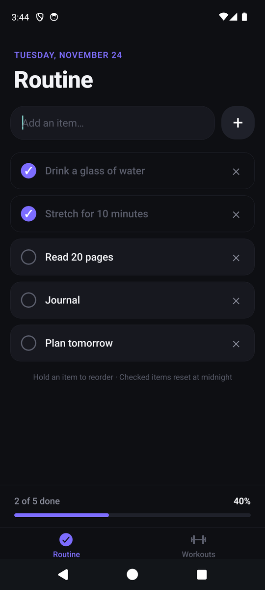
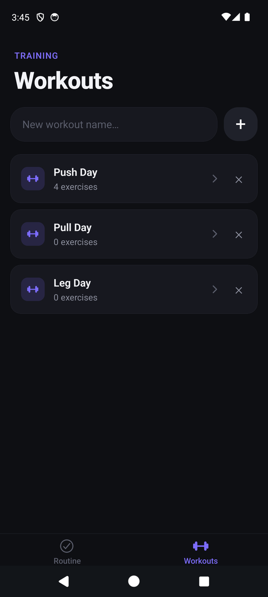
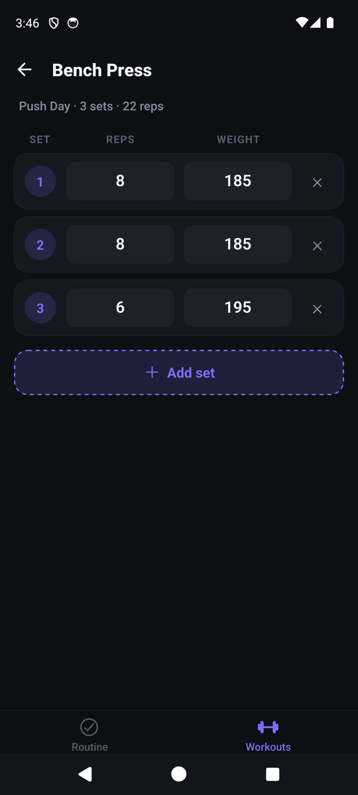

# Habits Tracker

An Android app for a daily routine checklist and a workout log, backed by a .NET API and PostgreSQL.

- **Routine:** a checklist you reorder by holding and dragging. Checked items reset at midnight.
- **Workouts:** named workouts, each with a list of exercises. Each exercise records its sets, reps and weight.

<p align="center">
  
  
  
</p>

---

## Install on your phone


1. On your Android phone, scan the QR code with the camera app. It opens the latest APK:
   <https://github.com/Chasertx/HabitsTracker/releases/latest/download/HabitsTracker.apk>
2. Open the downloaded `HabitsTracker.apk`. If Android asks, allow your browser to **install unknown apps**.
3. If Google Play Protect warns that the app is unrecognised, choose **Install anyway**. The app is signed by this project's own key, not by the Play Store.

Installing a newer release over the old one keeps your data, because the data lives on the server.

> The app needs an internet connection. The free server sleeps after 15 minutes idle,
> so the first screen after a break can take up to a minute to load.

---

## Features

### Routine
- **Add items** from the box under the title.
- **Check items off.** The progress bar at the bottom shows how many are done.
- **Reorder:** hold an item about a third of a second until it lifts, then drag it.
- **Delete:** tap **×** once to arm it (it turns red), then tap it again within 3 seconds.
- **Midnight reset:** checked items come back unchecked after midnight in your phone's time zone.
  - If an unchecked item with the same name already exists, the checked copy is removed instead of creating a duplicate.
  - Names are compared ignoring case and surrounding spaces.
  - The reset happens when the list loads, so it still applies if the app or server was off at midnight.

### Workouts
- **Create workouts** by name. Each shows its exercise count.
- **Open a workout** to add or remove exercises. Each exercise shows its set count.
- **Open an exercise** to log its sets:
  - **Add set** copies the previous set's reps and weight.
  - Edit reps and weight inline. Changes save when you leave the field or the screen.
  - Remove a set with the two-tap **×**.
- Weight is unitless: use lb or kg consistently.

The Routine and Workouts tabs stay visible on every screen.

---

## How it fits together

```
┌────────────────────────────┐   HTTPS + X-Api-Key   ┌─────────────────────────────┐        ┌──────────────────┐
│  mobile/  (Android app)    │ ────────────────────▶ │  api/  (.NET 8 minimal API) │ ─────▶ │  PostgreSQL 16   │
│  Expo SDK 58 · React       │                       │  EF Core · Docker           │        │  Render (free)   │
│  Native 0.88 · Expo Router │ ◀──────────────────── │  Render web service (free)  │ ◀───── │                  │
└────────────────────────────┘          JSON         └─────────────────────────────┘        └──────────────────┘
```

| Part | Tech | Where it runs |
| --- | --- | --- |
| `mobile/` | Expo SDK 58, React Native 0.88, React 19, TypeScript, Expo Router (tabs + stacks), Reanimated 4, Gesture Handler 3 | Android phone (APK built by EAS) or an emulator via Expo Go |
| `api/` | .NET 8 minimal API, EF Core 8 with Npgsql and migrations, packaged as a Docker image | Render free web service, deployed from this repo by `render.yaml` |
| Database | PostgreSQL 16 | Render free Postgres in production; Docker (`docker-compose.yml`) locally |

---

## Repository layout

```
.
├── api/                         .NET 8 API
│   ├── Program.cs               Startup: database, CORS, API key, endpoint mapping
│   ├── Endpoints/               Items (routine), Workouts, Exercises and sets
│   ├── Models/                  ListItem, Workout, Exercise, ExerciseSet
│   ├── Data/
│   │   ├── AppDbContext.cs      EF Core model and relationships (cascade deletes)
│   │   └── DatabaseConfig.cs    Reads DATABASE_URL or ConnectionStrings:Default
│   ├── Services/
│   │   ├── DailyReset.cs        Midnight reset and duplicate rules
│   │   └── ApiKeyMiddleware.cs  Optional X-Api-Key check for /api routes
│   ├── Migrations/              EF Core migrations, applied on startup
│   └── Dockerfile               Production image built by Render
├── mobile/                      Expo / React Native app
│   ├── src/app/                 Routes (Expo Router)
│   │   ├── (tabs)/index.tsx     Routine tab
│   │   └── (tabs)/workouts/     Workouts tab: list, workout, exercise (sets) screens
│   ├── src/components/          Shared UI: DraggableList, DeleteButton, rows, composer
│   ├── src/api.ts               Typed API client
│   ├── app.json                 Expo config (name, package id, icons)
│   └── eas.json                 EAS build profiles (APK for sideloading)
├── scripts/
│   └── release-android.ps1      Build the APK on EAS and publish a GitHub Release
├── docs/                        README images (screenshots, install QR code)
├── docker-compose.yml           Local PostgreSQL for development
└── render.yaml                  Render Blueprint: API service and Postgres database
```

---

## Local development

### Prerequisites
- [.NET 8 SDK](https://dotnet.microsoft.com/download/dotnet/8.0)
- [Node.js](https://nodejs.org/) 20 or newer
- [Docker Desktop](https://www.docker.com/products/docker-desktop/), for local PostgreSQL
- Android Studio, with an Android emulator (AVD) set up
- Optional, for releases: [GitHub CLI](https://cli.github.com/) and an [Expo](https://expo.dev/) account

### 1. Start PostgreSQL
```powershell
docker compose up -d                     # postgres:16 on localhost:5432 (user/password/db: habits)
```

### 2. Run the API
```powershell
cd api
dotnet run --launch-profile http        # http://localhost:5248
```
On startup it applies all migrations to the local database. Locally no API key is required.

### 3. Run the app in the emulator
```powershell
cd mobile
npm install
npx expo start --android                # installs Expo Go on the emulator and opens the app
```
The emulator reaches your PC's `localhost` at `10.0.2.2`, which the app uses by default.

To run against the deployed API instead, set these before `npx expo start`:
```powershell
$env:EXPO_PUBLIC_API_URL = "{{API_URL}}"
$env:EXPO_PUBLIC_API_KEY = "<the API key>"
```

### Checks
```powershell
cd mobile; npx tsc --noEmit; npx expo lint
cd api;    dotnet build
```

### Changing the database schema
```powershell
dotnet tool restore                      # installs dotnet-ef from .config/dotnet-tools.json
cd api
$env:ASPNETCORE_ENVIRONMENT = "Development"
dotnet ef migrations add <Name>
```
Migrations run automatically when the API starts, both locally and on Render.

---

## API reference

All `/api` routes take and return JSON. When the `ApiKey` setting is set (it is in production), each `/api` request needs an `X-Api-Key` header.

| Method | Route | Purpose |
| --- | --- | --- |
| GET | `/health` | Liveness check (no key needed) |
| GET | `/api/items?timeZone=America/Chicago` | Routine items in order. Applies the midnight reset for that IANA time zone first |
| POST | `/api/items` | Add an item `{ "title": "..." }` |
| PATCH | `/api/items/{id}` | Update `{ "title"?, "isCompleted"? }` |
| PUT | `/api/items/order` | Reorder `{ "ids": [3, 1, 2] }` |
| DELETE | `/api/items/{id}` | Delete an item |
| GET | `/api/workouts` | Workouts with exercise counts |
| GET | `/api/workouts/{id}` | A workout with its exercises (and their set counts) |
| POST | `/api/workouts` | Create `{ "name": "..." }` |
| PATCH | `/api/workouts/{id}` | Rename `{ "name": "..." }` |
| DELETE | `/api/workouts/{id}` | Delete a workout, its exercises and their sets |
| POST | `/api/workouts/{id}/exercises` | Add an exercise `{ "name": "..." }` |
| DELETE | `/api/workouts/{id}/exercises/{exerciseId}` | Remove an exercise and its sets |
| GET | `/api/exercises/{id}` | An exercise with its sets |
| PATCH | `/api/exercises/{id}` | Rename `{ "name": "..." }` |
| POST | `/api/exercises/{id}/sets` | Add a set `{ "reps"?, "weight"? }`; omitted values copy the previous set |
| PATCH | `/api/sets/{id}` | Update `{ "reps"?, "weight"? }` (reps 0–1000, weight 0–10000) |
| DELETE | `/api/sets/{id}` | Delete a set |

Invalid input returns `400` with a validation problem body. Unknown ids return `404`.

---

## Deployment

### API and database → Render

[`render.yaml`](render.yaml) is a Render Blueprint that defines two things:
- `habits-tracker-api`: a free Docker web service built from `api/Dockerfile`, with health checks on `/health`.
- `habits-db`: a free PostgreSQL 16 database.

The service gets its settings from environment variables:

| Variable | Value | Purpose |
| --- | --- | --- |
| `DATABASE_URL` | Linked automatically from `habits-db` | The API converts this `postgres://` URL into a connection string |
| `ApiKey` | A random secret, entered when the Blueprint is created | Required as `X-Api-Key` on `/api` requests |
| `PORT` | Set by Render | The port the API listens on |

**First-time setup:**
1. In the [Render dashboard](https://dashboard.render.com/), choose **New → Blueprint**.
2. Connect your GitHub account and pick this repository.
3. Render reads `render.yaml`. Enter the `ApiKey` value when asked, then choose **Apply**.

**Redeploying:** Render redeploys automatically on every push to `main` that changes files under `api/`.

The production API is at **{{API_URL}}** (health check: `{{API_URL}}/health`).

**Free-tier limits:**
- The web service sleeps after 15 minutes without traffic and takes up to a minute to wake.
- The free database **expires 30 days after it was created** unless you upgrade it, so upgrade before then to keep your data.
- The free database has 1 GB of storage.

### Android app → EAS build → GitHub Release

The APK is built on [EAS](https://expo.dev/eas) using the `preview` profile in `mobile/eas.json`, which produces an installable APK.
- **API URL:** set in `eas.json`.
- **API key:** stored as the EAS environment variable `EXPO_PUBLIC_API_KEY` in the `preview` environment, so it isn't committed. Note that it's still compiled into the app.

To publish a new version:
```powershell
./scripts/release-android.ps1 -Tag v1.0.1 -Notes "What changed"
```
The script builds the APK, downloads it, and creates a GitHub Release with the asset `HabitsTracker.apk`. The QR code always points at `releases/latest/download/HabitsTracker.apk`, so it never needs regenerating.

To change the API key:
1. Update `ApiKey` in the Render dashboard (service → **Environment**).
2. Update the EAS variable:
   ```powershell
   cd mobile
   npx eas-cli env:update --variable-name EXPO_PUBLIC_API_KEY --variable-environment preview --value <new>
   ```
3. Publish a new release.

---

## Security notes

- The API key is compiled into the APK. It keeps casual traffic off the public API, but it isn't user authentication. Anyone who extracts it from the app can use the API.
- There are no user accounts: everyone using the same server shares one routine and one set of workouts.
- CORS allows any origin. The phone app doesn't need CORS; this only matters for browser clients.

---

## Troubleshooting

| Problem | Fix |
| --- | --- |
| App shows "Can't reach the server" right after opening | The free Render service was asleep. Wait a few seconds, then pull down to refresh. |
| Data disappeared after about a month | The free Render database expired. Upgrade it in Render before 30 days to avoid this. |
| `dotnet run` fails to connect to the database | Start PostgreSQL with `docker compose up -d`, and check Docker Desktop is running. |
| `dotnet run` fails with *An Application Control policy has blocked this file* | Windows Smart App Control blocks freshly built DLLs. Turn it off in Windows Security → App & browser control. |
| Emulator app can't reach the local API | Make sure the API is running on port 5248. The emulator must use `10.0.2.2`, not `localhost`. |
| Phone refuses to install the APK | Allow your browser or file manager to install unknown apps (Settings → Apps → Special app access). |
| `dotnet build` fails because the `.exe` is locked | A `dotnet run` instance is still running. Stop it first. |
